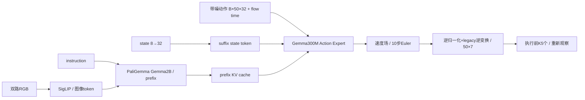

# Robust-Pi：低资源 π₀ 适配、闭环评测与失败诊断

基于固定版本 **openpi π₀ + LIBERO** 的 VLA 实习工程项目：在 **RTX 5070 12GB / WSL2 20GB** 下完成数据准备、LoRA pilot、低资源加载、闭环评测与失败定位。

**真实结果：Clean 0/2、Visual OOD 0/2，四条回合均 timeout。** 工程链路通过不等于策略能力达标。本项目展示可追溯训练工程、受控评测与缺陷诊断，尚无鲁棒性提升或完整 benchmark 结论。

[English](README_EN.md) · [MIT](LICENSE) · [结构图](docs/PROJECT_ARCHITECTURE.md) · [代码导航](docs/CODE_GUIDE.md) · [简历与面试](docs/INTERNSHIP_PROJECT.md)

## 已完成的工程工作

| 环节 | 实际完成 | 证据边界 |
|---|---|---|
| 数据 | 五任务各40-shot训练池，共200条；episode级40/5/5、train-only统计、H50 chunk | 250条结构有效示范中236条旧回放通过，限制保留 |
| 训练 | π₀ LoRA配置、batch1、100/100更新、100条有限loss | 100-step pilot，仍处默认1000步warmup |
| checkpoint | Orbax params+assets，结构/fresh reload/冻结叶审计 | 不含optimizer恢复状态；非adapter-only训练 |
| 推理 | 本地GPU动作块`(50,7)`；复用固定模型和stats | 无CPU回退；不据此声明机器人任务学会 |
| 评测 | 两条旧Clean + 两条新Visual OOD；每条220步/44次推理/221帧 | 同task的两对小样本；没有完整LIBERO benchmark |
| 资源 | G2总GPU占用峰值9004MiB，最低RAM可用6.44GiB、GPU free2940MiB | 离散采样可能漏瞬时峰值 |
| 诊断 | 源码和真实数据静态审计定位180°图像方向不一致 | 修复只形成提案，尚无修复后的任务成功率验证 |

官方E0不计入自训E1。E2初始化OOM后为0步、无checkpoint；E3/E4/E5训练未执行。原始实验没有被重跑或覆盖。

## π₀在本项目中的实现



两Gemma分支使用同一多分支attention实现，分支权重不同。LoRA rank分别为16/32；视觉与投影等未冻结参数也可更新。H=50、重规划K=5、flow积分10步是三个独立量，详见[实际结构与训练/推理流程](docs/PROJECT_ARCHITECTURE.md)。

## CPU快速检查

候选版含真实项目代码和纯合成CPU演示；不含权重、数据、私密日志或仿真环境。在Python3.11及[CPU依赖](requirements-cpu.txt)可用的环境中：

```bash
python3 scripts/cpu_demo.py
python3 -m pytest -q -p no:cacheprovider tests/test_public_cpu.py
python3 tools/audit_release.py
```

合成演示只检查chunk/manifest/指标约定，不是新增机器人实验。CPU依赖版本来自已执行检查的环境；本阶段没有安装依赖或下载资产。[复现指南](docs/REPRODUCTION_GUIDE.md)明确区分公开CPU检查与依赖私有资产的历史重型入口。

## Known Limitations

- **G3确认：正式训练图像与rollout输入方向相差180°。** 源码链路和真实HDF5/Parquet像素静态审计均支持；不是根据0成功率反推。见[失败分析](reports/FAILURE_ANALYSIS.md)。
- **尚无修复后的任务成功率验证。** 不声称该问题解释全部失败，也没有修改旧数据、checkpoint或G2结果。[CPU修复设计](docs/IMAGE_PREPROCESSING_PROPOSAL.md)尚未接入生产链路。
- **E1仅100-step pilot，不代表充分收敛。** 两对样本不能外推总体能力；Clean成功率为0，OOD retention为undefined/N/A，不能填0。
- 20个LoRA叶非零不单独证明相对初始化更新；该版本A/B均随机初始化。已有直接差值证据是17个冻结base叶一致、33个可训练非LoRA base叶改变。
- 公开版只对CPU检查和发布文件完成验收；不承诺clone后可直接训练或复现GPU成功率，也不声称实时机器人部署。

## 结果、媒体与发布范围

[实验摘要](reports/EXPERIMENTS.md) · [脱敏数值](reports/public_results.json) · [发布审计](reports/G4_PUBLIC_RELEASE_AUDIT.md) · [发布清单](docs/GITHUB_RELEASE_CHECKLIST.md)

Demo视频、含第三方渲染资产的截图和既有图表均未获得可确认的再分发结论，**本候选版全部不收录**。仅提供[媒体说明与授权本地复核路径](docs/MEDIA_POLICY.md)，没有指向缺失私有文件的Markdown链接。Mermaid图来自项目实现说明，不包含数据集图像。

这是白名单隔离导出的候选版，**不含原Git历史**。自有代码按用户确认的MIT许可，Copyright © 2026 youlinw666；上游来源与许可范围见[Third-party notices](docs/THIRD_PARTY_NOTICES.md)。本阶段不自动提交、推送或公开上传。
