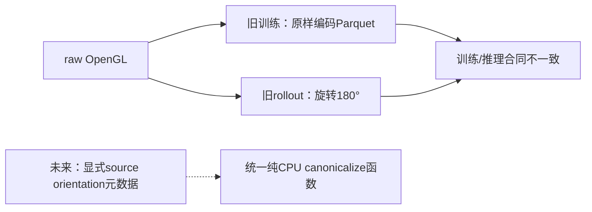

# CPU-only图像预处理修复设计：尚未实施

G3通过源码链路与真实数据像素审计确认：formal转换原样保存raw OpenGL相机图像，训练Adapter不旋转；rollout先180°旋转再resize。该缺陷存在，不等于其独立解释了全部任务失败。

## 提议的接口与回归，不是已实现的修复

1. 图像元数据显式区分`raw_opengl`与`canonical`，拒绝未知值；已经定向的参考源不能二次旋转。
2. 统一纯CPU的“方向整理→resize”函数，由未来训练读取与推理输入共同调用；图像整理不旋转机器人world state/action。
3. 用非对称合成RGB验证180°方向、重复调用策略、两视角一致性、dtype/shape、无原数组就地修改；用授权真实帧验证训练与rollout两条构建路径得到同一canonical表示。
4. 保留同一episode划分，创建新数据/配置/manifest版本，记录新hash及统计来源；不得翻转旧Parquet或覆盖旧stats/checkpoint。
5. 先完成CPU回归。任何后续GPU因果对照或重训都需新身份和单独范围；本阶段没有实施、运行或安排这些实验。

现有公开CPU测试覆盖原来的协议组件，不应被描述为“图像修复已经通过真实回归”。没有修复后的成功率，也不保证修复后任务能成功。
