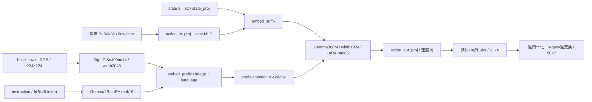
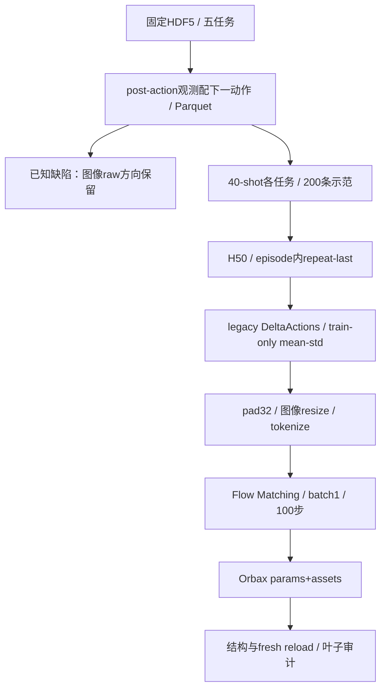
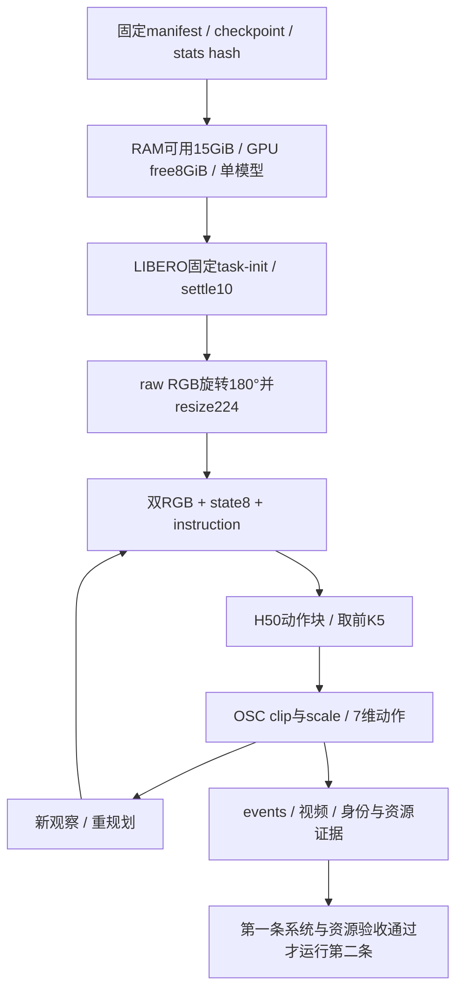

# 实际模型结构与训练/推理流程

依据固定openpi `215abfb217dbac7d5f1273282331b9b1866c0479` 与LIBERO `f78abd68ee283de9f9be3c8f7e2a9ad60246e95c`。对应上游文件为`models/pi0.py`、`pi0_config.py`、`gemma.py`、`training/config.py`和`policies/libero_policy.py`。候选版不复制整个上游checkout，固定来源见[upstream.lock.json](../upstream.lock.json)。

## 模型

PaliGemma前缀与动作expert是同一多分支Gemma模块中的不同权重分支，不是外接自然语言planner。π₀使用连续state token和时间MLP，不套用π₀.₅的adaRMS分支。缺失right wrist补零并mask=false。两个分支LoRA alpha/r均为1；冻结规则不涵盖所有视觉/投影参数。

Flow Matching：`x_t=t*epsilon+(1-t)*a`，训练目标`epsilon-a`，MSE拟合速度场；源码约定`t=1`为噪声、`t=0`为动作。推理负步长Euler，动作连续生成。H50、K5和flow10的含义互不替代。

## 历史训练流程

E1“clean”指未启用项目E3/E4/E5增强训练，上游train=True仍有crop、±5°旋转和颜色增强。数据时间合同为`raw_obs[t]→action[t+1]`。mean/std在legacy变换后计算，状态/动作再pad到32。尾部repeat-last没有被loss mask排除，不能将全部loss当作真实动作维度或任务成功率。

## 历史推理与闭环流程

推理端`[::-1,::-1]`与训练端保留raw方向形成G3确认的差异。本图描述实际旧实现，并非已修复管线。动作输出已反归一化，客户端不做第二次反归一化；控制器对位置/旋转分量裁剪后分别缩放至每分量±0.05m、±0.5rad。20Hz仿真控制频率不等于真实机器人20Hz实时系统。

模型源图、训练源图、评测源图另保留在[diagrams目录](diagrams/model.mmd)。代码入口与资产边界见[代码导航](CODE_GUIDE.md)。
